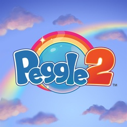

<h1 align=center>Peggle 2: Nintendo Switch port</h1>

<b>peggle2-nx 1.0.2</b> · <a href="https://chanseyisthebest.github.io/peggle2-nx-installer/">web installer</a> · <a href="https://github.com/ChanseyIsTheBest/peggle2-nx/releases/tag/v1.0.2">release</a>

An unofficial native port of the Xbox 360 (Xbox Live Arcade) version of **Peggle 2**, with everything the PS4
**Magical Masters Edition** added. Made by static recompilation with [ReXGlue](https://github.com/rexglue/rexglue-sdk).
No emulator.

This repository contains no game files. You need your own copies of both games: the Xbox Live Arcade content package
from an Xbox 360 (`58411436`) and the PS4 Peggle 2 Magical Masters Edition base package (`CUSA00743`), which holds its DLC.

## Playing it on the Switch

1. Open the web installer: **https://chanseyisthebest.github.io/peggle2-nx-installer/**
2. Give it your Xbox 360 package (`2452FB99DD4F3E052C919B780FEAE8F8E8281CF058`, or the whole `58411436` folder) and
   your PS4 base package (`CUSA00743`), then press **Create peggle2-nx.zip**. Your files never leave your computer.
3. Extract `peggle2-nx.zip` into `sdmc:/switch/`.
4. Start it with a title override (hold **R** while starting an installed game) or a forwarder.

- Album applet mode does not give the game enough memory.
- A forwarder must be set to a **39-bit address space**.
- Updating: press **Create peggle2-nx-update.zip** on the installer page and extract it over your folder (settings,
  save and game files stay). From 1.0.0: set `peggle2_fps = 60` in `peggle2.toml`, or delete the file.
- The first time you play after installing or updating, the game can stutter for a moment in new places while it
  compiles shaders. Later sessions start smoothly.

Features:

- The PS4 masters **Windy** and **Jimmy Lightning**: their areas, ten levels and ten trials each, videos, music and voices.
- Six costumes for every master (press **Y** on the Select a Master screen or in the multiplayer lobby).
- The PS4's 1080p art for nearly every sprite; 1920x1080 docked, 1280x720 handheld.
- Local multiplayer with seven masters and up to four players, each on their own controller.
- Native deko3d renderer (Renut); 60 fps by default (`peggle2_fps = 30` for the Xbox 360's 30).
- English, German, French, Spanish, Italian and Brazilian Portuguese (`peggle2_language`).
- Face buttons work by position as on the Xbox 360 pad (`input_xbox_layout = false` for by letter); per-player
  button maps (`input_p1_a = "B, ZR"` and so on); single Joy-Cons held sideways, one per player.
- Settings are in `peggle2.toml` next to the NRO; delete it to get the defaults back.

## Building

Needs Windows with LLVM clang 20 and the VS 2022 Build Tools (PC build); devkitA64, libnx and deko3d from
[devkitPro](https://devkitpro.org) (Switch build), with uam and SPIRV-Cross built for the PC
(`tools/deko3d_build_tools.sh`); Python with numpy, Pillow, lz4 and xxhash; and your own copies of both games.

The steps (PC test build, NRO, game data with the PS4 content, 1080p art pack, SD folder) are in
[docs/building.md](docs/building.md). More in [docs/peggle2-notes.md](docs/peggle2-notes.md) and
[docs/plan.md](docs/plan.md).

## Credits and license

- **PopCap Games**: creators of Peggle 2. This is an unofficial, fan-made port.
- **ChanseyIsTheBest**: this port.
- **[Tom Clay](https://github.com/rexglue/rexglue-sdk)**: the ReXGlue SDK, built on the work of the
  **[Xenia](https://xenia.jp)** team.
- **[StevensND](https://github.com/StevensND/nfsmw-nx)**: nfsmw-nx (the SDK's Switch layer, the NVK build and much of
  the method) and [nfsmw-nx-installer](https://github.com/StevensND/nfsmw-nx-installer), which the installer page is
  built on.
- **[masterspike52](https://github.com/masterspike52/reNut)**: reNut, the renderer (reused with its author's permission).
- **banjo-nx** (Banjo-Kazooie: Nuts & Bolts port): Renut's Switch port (plume's deko3d back end, the shader generator,
  render-thread and input-latency work).
- **[renderbag](https://github.com/renderbag/plume)**: plume. **[fincs](https://github.com/devkitPro/uam)** and
  devkitPro: deko3d and uam.
- **[nebadasSwifty](https://github.com/nebadasSwifty/masseffect-nx)**: masseffect-nx, the renderer of 1.0.0.
- **[hedge-dev](https://github.com/hedge-dev/XenosRecomp)**: XenosRecomp.
- **[danfromtico](https://github.com/danfromtico/mesa-switch)** and **[NaGaa95](https://github.com/NaGaa95/mesa-switch)**:
  mesa-switch (Mesa, NVK and NAK on Horizon).
- **[devkitPro](https://devkitpro.org)** and **[switchbrew](https://github.com/switchbrew/libnx)**: devkitA64 and libnx.
- The sibling ports (Sonic Adventure 2, Banjo-Kazooie: Nuts & Bolts, Sonic & All-Stars Racing Transformed,
  Mushihimesama Futari), which share their fixes; for 1.0.1 Sonic Adventure 2's renderer CPU work and Mushihimesama
  Futari's sprite-draw deltas.
- The other libraries in [THIRD_PARTY_NOTICES.md](THIRD_PARTY_NOTICES.md).

GPL-3.0 (see [LICENSE](LICENSE)); the SDK keeps its BSD-3-Clause license (see
[THIRD_PARTY_NOTICES.md](THIRD_PARTY_NOTICES.md)).

No affiliation with PopCap Games, Electronic Arts, Microsoft, Sony or Nintendo. "Peggle" is a trademark of PopCap
Games / Electronic Arts; the icon artwork is © PopCap Games. This repository contains no assets or program code from
the original games: you provide your own legally obtained copies, and everything made from them is made on your own
computer. Running homebrew requires custom firmware, which violates Nintendo's ToS and can get a console banned.
