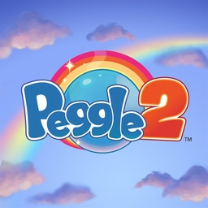

<div align=center>



</div>
<h1 align=center>Peggle 2 — Nintendo Switch port</h1>

A native Nintendo Switch port of the Xbox 360 (Xbox Live Arcade) version of **Peggle 2** (2014), with everything the
PS4 **Magical Masters Edition** added: the masters Windy and Jimmy Lightning with their areas and trials, the costume
packs, and the PS4's 1080p art.

It's not an emulator. The PowerPC code of the game's `default.xex` is statically recompiled to C++ with
[ReXGlue](https://github.com/rexglue/rexglue-sdk) and compiled for the Switch, and since 1.0.1 the game is drawn by
Renut's Direct3D-level renderer ([reNut](https://github.com/masterspike52/reNut) by masterspike52, as banjo-nx
carries it) directly on the Switch's own graphics API, deko3d. The PS4 edition's content is converted from your own
PS4 copy into the Xbox 360 game's data, and the parts of the PS4 game the Xbox 360 program never had (Windy's and
Jimmy's powers) are written for the port.

## What's new in 1.0.1

- **A new renderer:** the game's Direct3D calls are drawn directly with deko3d (no emulated GPU command ring, no
  EDRAM model, no Vulkan driver in the NRO: it is 10 MB smaller). Faster on the console, so the game now runs at
  **60 pictures a second by default** (`peggle2_fps = 30` gives the Xbox 360's 30).
- **Local multiplayer fixed:** in a duel, player 2's controller did nothing (player 2's turns took player 1's
  controller). Every player now plays with their own controller.
- **Lower input latency:** the controller is read as late as the frame allows, and the frame pacing follows the
  screen's refresh.
- **The shaders for the new renderer are made by the installer** from your copy, like the rest (`deko3d_glsl.bin`).
- Built with LTO and PGO again (the profile from an emulator session this time).

> [!NOTE]
> You need your own copies of **both** games:
> - the **Xbox Live Arcade** game, its content package from an Xbox 360
>   (`Content/0000000000000000/58411436/000D0000/2452FB99DD4F3E052C919B780FEAE8F8E8281CF058`);
> - **Peggle 2 Magical Masters Edition** for PS4 (`CUSA00743`) with its DLC: the base package holds the content of
>   the DLC (Windy, Jimmy, the Garden and Spooky costume packs), which the port turns on.
>
> This is the one supported setup: the Xbox 360 game with all of the PS4 content and the 1080p art.

## How to install

1. Open the installer page: **https://chanseyisthebest.github.io/peggle2-nx-installer/**
2. Choose your Xbox 360 package (`2452FB99DD4F3E052C919B780FEAE8F8E8281CF058`, or the whole `58411436` folder copied
   from your console) and your PS4 base package (`CUSA00743`). Then press **Create peggle2-nx.zip**. Everything runs
   in your browser and the game files never leave your computer: the page checks your copies, downloads the build,
   converts the PS4 content, makes the 1080p art, the shaders and the game pack from your files.
3. Extract the downloaded `peggle2-nx.zip` into `sdmc:/switch/`.

Your `peggle2-nx` folder should look like this:

```text
/switch/peggle2-nx/
  peggle2.nro
  LICENSES.txt
  peggle2.toml              (your settings; written at the first start when it is missing)
  deko3d_glsl.bin           (the game's shaders for the deko3d renderer, made from your copy)
  peggle2_shaders.mesp      (the shaders of the earlier renderer; 1.0.1 does not read them)
  peggle2_shaders.mesp.idx
  game_root.nxpack          (the Xbox 360 game with the PS4 content, in one file)
  game_root.nxidx
  peggle2_hd.pack           (the 1080p art, made from your PS4 copy)
```

Launch it with a game override (hold **R** while starting an installed title) or a forwarder. Album applet mode does
not give the game enough memory. If you use a forwarder, set it to a **39-bit address space**.

To build everything yourself instead, see [docs/building.md](docs/building.md).

> [!NOTE]
> **Updating:** open the installer page again and press **Create peggle2-nx-update.zip**. It only holds the new
> `peggle2.nro` and the shaders, so there is no need to convert the games again: extract it over your folder. Your
> `peggle2.toml`, your save, the game files and the `cache` folder stay.
> From 1.0.0: your `peggle2.toml` still says `peggle2_fps = 30`; set it to `60` (the new default) or delete the
> file so the game writes the new one.

> [!CAUTION]
> **The first time you play** after installing or updating, the game compiles the shader variants it has not seen
> yet, so **IT CAN STUTTER for a moment** in new places. They are saved in `deko3d_shaders.bin` next to the NRO and
> later sessions start smoothly.

## What the PS4 edition adds

- **Windy** (Hallelujah Hollow, her Fairy Flock power) and **Jimmy Lightning** (Jimmy's Jammin' Jaunt, his Multiball
  power): ten levels and ten trials each, their intro videos with sound, their music and voices.
- **Six costumes for every master**: the Garden and Spooky packs for the five launch masters, and Windy's and Jimmy's
  own. Change them with **Y** on the Select a Master screen (it opens when you choose a level you have beaten) and
  in the multiplayer lobby.
- **Seven masters in local multiplayer**, in the PS4's lobby layout, and up to four players: controllers 2 to 4 join
  as guests of your profile.
- **The PS4's 1080p art** for nearly every sprite of the game, in handheld mode too.

## Controls

By default the face buttons work **by position, as on the Xbox 360 pad** the game was made for: the bottom button
shoots (the Xbox's A), the right one is the Xbox's B, and so on.

<div align="center">

| Switch | Xbox 360 |
| --- | --- |
| B (bottom) | A |
| A (right) | B |
| Y (left) | X |
| X (top) | Y |
| ZR / ZL | RT / LT |
| R / L | RB / LB |
| + | Start |
| − | Back |
| Sticks / D-pad | Sticks / D-pad |

</div>

To use the buttons by letter instead (the Switch's A acts as A), set `input_xbox_layout = false` in `peggle2.toml`.

**Multiplayer:** every controller is its own player, in the order they connect. The console in handheld mode counts
as one, so handheld + a Pro Controller makes players 1 and 2. Single Joy-Cons are held sideways, one per player.

**Remapping:** each player has a button map in `peggle2.toml` (`input_p1_a = "B, ZR"` and so on).

## Settings

`peggle2.toml`, next to the NRO, holds only your options. Everything else is built into the NRO.

<div align="center">

| Setting | What it does |
| --- | --- |
| `peggle2_fps` | `60` (default): a picture every screen refresh. `30`: as the Xbox 360 game. The game runs at the same speed either way |
| `peggle2_language` | `en`, `de`, `fr`, `es`, `it` or `pt` (Brazilian Portuguese); empty = English |
| `input_xbox_layout` | Face buttons by position (`true`, default) or by letter (`false`) |
| `input_joycon_sideways` | Single Joy-Cons held sideways, one per player (`true`, default) |
| `input_p1_a` ... `input_p4_right` | Each player's buttons: for every Xbox button, the Switch buttons that press it, e.g. `input_p1_a = "B, ZR"` |

</div>

If you delete `peggle2.toml`, the game writes the default one again at the next start.

## Resolution

The game draws **1920x1080** docked and **1280x720** in handheld mode, both with the PS4's 1080p art (in handheld
mode filtered down to the screen), and switches when you dock or undock.

## Performance

The game runs at **60 FPS** by default: a picture after every one of its 60 logic steps a second (the Xbox 360 version
draws after every second one; `peggle2_fps = 30` does that). How close the console gets to 60 depends on the scene;
where a picture is late, the game shows fewer pictures but keeps its speed.

The released NRO is built with LTO and with PGO (1.0.1: from an emulator session).

## How it works

- **The game's code is translated, not emulated.** [ReXGlue](https://github.com/rexglue/rexglue-sdk) translates every
  function of the game's program to C++, which is then compiled for the Switch. ReXGlue also gives the game what it
  expects from an Xbox 360: its system, files, audio and controllers. The port adds the Switch part: memory, threads,
  crash handling, clocks, audio output and showing the frames on screen.
- **Renut's renderer on deko3d.** Imitating the Xbox 360 GPU was far too slow on the Switch. Since 1.0.1 the game's
  Direct3D calls are drawn directly by Renut's Direct3D-level renderer ([reNut](https://github.com/masterspike52/reNut)
  by masterspike52, in banjo-nx's Switch port of it) through [plume](https://github.com/renderbag/plume)'s deko3d back
  end: no GPU command ring and no EDRAM model. The work per draw is split between the game's thread and a render
  thread, and only what changed in the Direct3D device is sent for each draw.
- **Shaders translated beforehand.** The game stores three of its GPU programs; the installer translates them with
  [XenosRecomp](https://github.com/hedge-dev/XenosRecomp), DXC and SPIRV-Cross into deko3d's GLSL in your browser
  (`deko3d_glsl.bin`). The three the game compiles at run time (the video shaders) are written for the port and
  built into the NRO. The console compiles each shader variant once with [uam](https://github.com/devkitPro/uam) and
  keeps it in `deko3d_shaders.bin`.
- **The PS4 content.** Both editions use PopCap's resource archive, the PS4's in the other byte order, with its art at
  1080p in console-tiled textures, its sound in ATRAC9 and its masters' powers in code the Xbox 360 program lacks.
  The installer converts the archive's content into the Xbox 360 game's (animations, levels, costumes, videos, sound
  banks), and the port adds the Fairy Flock and Multiball powers, the PS4's screens for seven masters and six
  costumes, and the 1080p art as a pack of atlases laid out like the game's own 720p ones.
- **Graphics driver.** deko3d, the Switch's own graphics API from devkitPro; 1.0.0 used Vulkan on NVK (Mesa, through
  [mesa-switch](https://github.com/danfromtico/mesa-switch)), which the 1.0.1 NRO no longer contains.
- **Optimization.** The busiest game functions run as translated native code (checked against the original in the
  test builds), the code generator keeps registers in C++ locals and makes calls direct, and the build uses LTO and
  PGO from a console session.

## Documentation

<div align="center">

| Document | What it explains |
| --- | --- |
| [docs/building.md](docs/building.md) | How to build the PC test build, the NRO, the game data with the PS4 content, the 1080p art pack and the SD folder |
| [docs/peggle2-notes.md](docs/peggle2-notes.md) | Notes on the game's code, the PS4 content and every change, each with its evidence |
| [docs/plan.md](docs/plan.md) | The stages of the port |

</div>

## Build

Windows, LLVM clang 20 and the VS 2022 Build Tools for the PC build; devkitA64, libnx and deko3d from
[devkitPro](https://devkitpro.org) for the Switch, with uam and SPIRV-Cross built for the PC
(`tools/deko3d_build_tools.sh`); Python with numpy, Pillow, lz4 and xxhash; and your own copies of both games. The
whole process is in [docs/building.md](docs/building.md).

<div align="center">

| Folder | Contents |
| --- | --- |
| `app/` | The game: hooks, Renut's renderer (`app/src/renut_engine`), the earlier native renderer, native functions, the PS4 powers, settings, CMake project; `app/thirdparty`: plume, uam, Dear ImGui and Renut's XenosRecomp |
| `sdk/` | ReXGlue SDK with the Horizon layer and the code generator changes |
| `shaders/` | XenosRecomp with the ports' changes, and the shader package tools |
| `tools/` | Code generation steps, build and test scripts, the PS4 content converter (`tools/ps4_dlc/`) and the 1080p art builder (`tools/hd/`) |
| `mesa/` | The NVK driver build 1.0.0 linked (1.0.1 has no Vulkan driver) |
| `docs/` | Documentation |

</div>

## Credits

- **PopCap Games** — creators of Peggle 2. This is an unofficial, fan-made port with no affiliation.
- **ChanseyIsTheBest** — this port.
- **[Tom Clay](https://github.com/rexglue/rexglue-sdk)** — the ReXGlue SDK, built on the work of the
  **[Xenia](https://xenia.jp)** team.
- **[StevensND](https://github.com/StevensND/nfsmw-nx)** — nfsmw-nx: the Switch layer of the SDK, the NVK build and
  much of the method; and [nfsmw-nx-installer](https://github.com/StevensND/nfsmw-nx-installer), the installer page
  this port's is built on.
- **[masterspike52](https://github.com/masterspike52/reNut)** — reNut: the Direct3D-level renderer 1.0.1 draws with
  (its reuse in this port permitted by its author).
- **banjo-nx** (Banjo-Kazooie: Nuts & Bolts Switch port) — Renut's Switch port: the deko3d back end of plume, the
  shader generator and its optimisations, the render-thread and input-latency work.
- **[renderbag](https://github.com/renderbag/plume)** — plume, the rendering layer Renut draws through;
  **[fincs](https://github.com/devkitPro/uam)** and devkitPro — deko3d and uam.
- **[nebadasSwifty](https://github.com/nebadasSwifty/masseffect-nx)** — masseffect-nx: the native renderer of 1.0.0.
- **[hedge-dev](https://github.com/hedge-dev/XenosRecomp)** — XenosRecomp, the Xenos shader translator.
- **[danfromtico](https://github.com/danfromtico/mesa-switch)** and **[NaGaa95](https://github.com/NaGaa95/mesa-switch)**
  — mesa-switch: Mesa, NVK and NAK on Horizon.
- **[devkitPro](https://devkitpro.org) and [switchbrew](https://github.com/switchbrew/libnx)** — devkitA64 and libnx.
- The sibling ports (Sonic Adventure 2, Banjo-Kazooie: Nuts & Bolts, Sonic & All-Stars Racing Transformed,
  Mushihimesama Futari), which share their fixes with this one; for 1.0.1 Sonic Adventure 2's renderer CPU work and
  Mushihimesama Futari's sprite-draw deltas.
- The other libraries listed in [THIRD_PARTY_NOTICES.md](THIRD_PARTY_NOTICES.md).

## Legal

No affiliation with PopCap Games, Electronic Arts, Microsoft, Sony or Nintendo. "Peggle" is a trademark of PopCap
Games / Electronic Arts; the icon artwork is © PopCap Games. This repository contains no assets or program code from
the original games. Users must provide their own legally obtained copies, and everything made from them (`assets/`,
`app/generated/`, the converted archive, the 1080p art pack, the shader packages) is made on their own computer.
Running homebrew requires custom firmware, which violates Nintendo's ToS and can get a console banned — your call.

Source code is provided under the GPL-3.0 License (see [LICENSE](LICENSE)), like the ports it builds on. The SDK keeps
its BSD-3-Clause license (see [THIRD_PARTY_NOTICES.md](THIRD_PARTY_NOTICES.md)).
